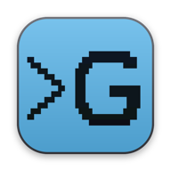
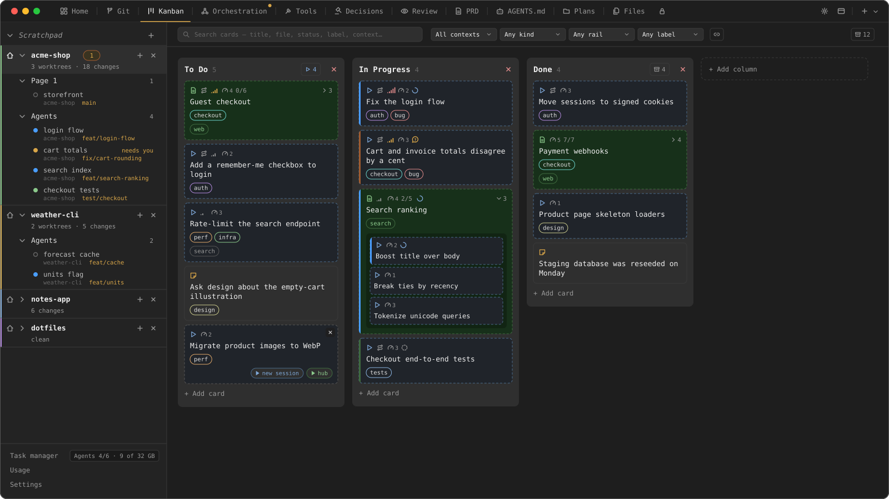
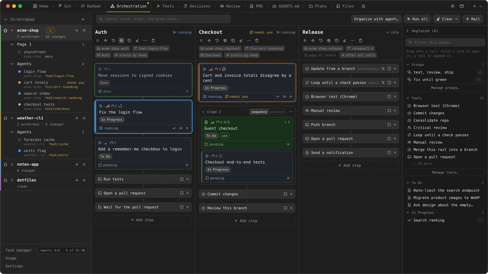
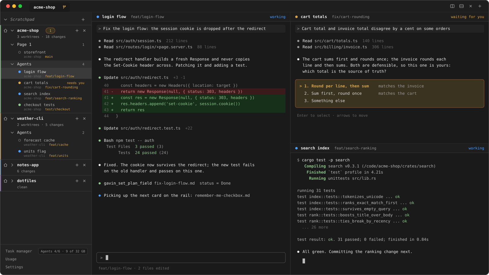
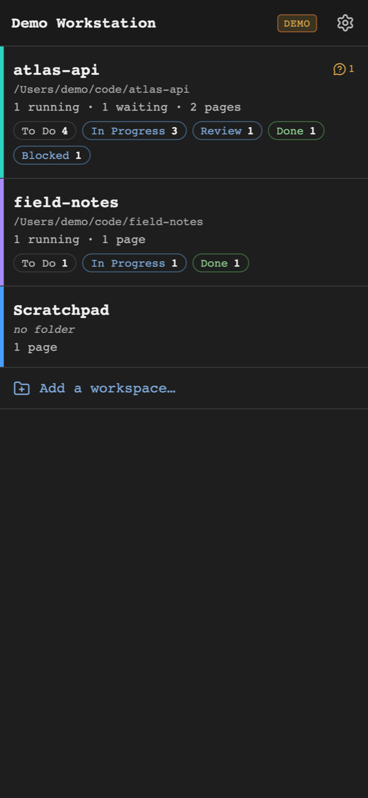
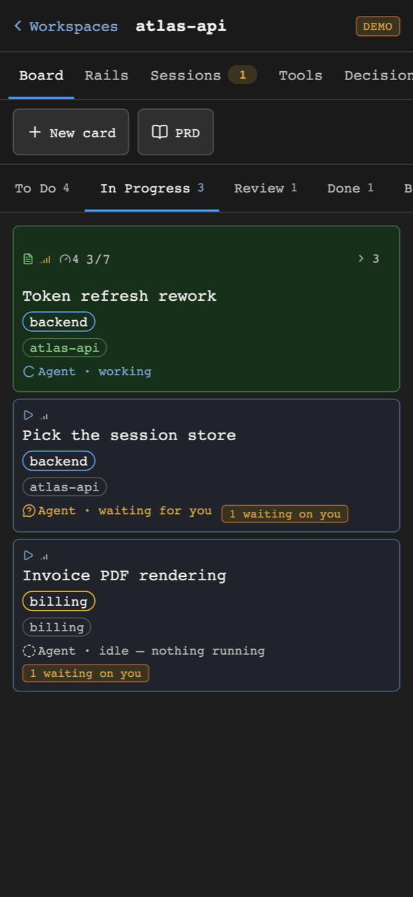
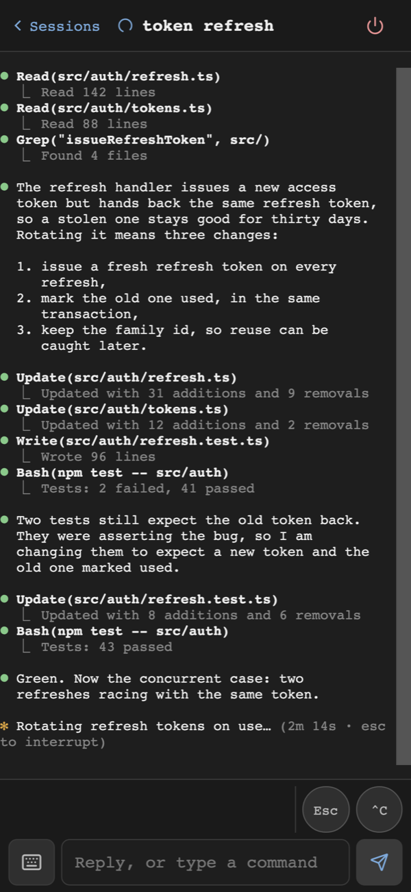
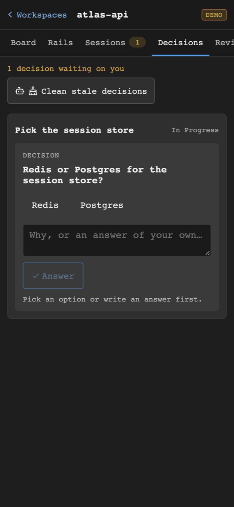

<p align="center">
  
</p>

<h1 align="center">Gavin</h1>

<p align="center">
  A desktop app for driving several AI coding agents at once — in real
  terminals, on a shared kanban board, without losing track of what each
  one is doing. And a phone app for when you are away from the desk.
</p>

<p align="center">
  <a href="LICENSE"></a>
  
  
  
</p>

<p align="center">
  
  <br>
  <sub>The images on this page are illustrative mock-ups — the projects, cards, branches and output are invented.</sub>
</p>

## Why

Agent work otherwise fragments into a dozen terminal windows, a chat
scrollback, and a mental to-do list. Gavin makes the work itself the
durable object: a card on a kanban board that is a markdown file inside
the repo. The human and the agents share one view of it.

Built for one developer running a fleet of agents across one or more
repos. See [`.gavin-root/PRD.md`](.gavin-root/PRD.md) for the full vision
and the settled architectural decisions.

## Features

Every workspace opens on a **hub** — Home, Git, Kanban, Orchestration,
Tools, Decisions, Review, and the repo's own PRD, `CLAUDE.md`, plans and
files as tabs. A **hub navigator** can sit beside a workspace's pages, so
any of those opens next to the terminals instead of in place of them.
Two of the tabs are where the work is decided; the terminals are where it
happens.

### Kanban that is the repo

Cards are plain markdown under `.gavin*/plans/`, committed alongside the
code, and come in three kinds: a **note** is a reminder, a **task** is one
unit of agent work whose body *is* the prompt, a **plan** is a checklist
that can nest tasks of its own. Statuses come from the board's columns.
Run a card and it becomes a live session — the card carries that
session's working / waiting / idle mark from then on. Labels, priority,
search and filters live on the same surface the agents write to over MCP,
so the board the human reads is the board the agents keep.

- **Complexity picks the agent.** A card's five-level complexity chooses
  which agent, model and thinking effort runs it; a card can also name
  its own.
- **Develop a one-liner.** A card that is only a line of intent can be
  developed into a plan — the agent interviews you first and writes
  nothing until you approve.
- **Best of N.** Run one card on several agents at once, each in a
  worktree of its own, tiled on one page, and keep the best result.
- **Run history and changes.** Every run of a card is kept with its
  tokens and duration, and opens on exactly the diff that run made.
- **Search by meaning.** When a keyword search comes back empty, the
  board offers the closest cards by meaning instead.
- **Review before run, commit after.** A first-run gate shows you what a
  card will ask an agent to do; a card can ask to be committed when its
  work is done.

### Orchestration rails

<p align="center">
  
</p>

A **rail** is a column of ordered steps bound to a worktree and a branch,
and it runs on a page of its own — so parallel work stays parallel,
visible, and in order. A step is either a card from the board or a
**tool**: run the tests, loop until a check passes, open a pull request
and wait for it, review the branch, merge in either direction, test in a
real browser (Chrome or Playwright), notify. Steps group into stages that
run in sequence or in parallel; a rail starts by hand, after another rail,
after all of them, or at a date and time you schedule. When an agent stops
to ask something, the rail says *needs you* and waits.

A **nodes view** draws the same rails like a commit graph, with running
and finished steps marked. The **Tools** tab is the library those steps
come from — edit a tool, run it on its own, and let agents author new
ones for the workspace over MCP.

### Real terminals

<p align="center">
  
</p>

Workspaces, pages, tabs and split panes over real PTYs. Each session
keeps its own idle / working / waiting status in the sidebar, with OS
notifications when an agent needs you. **⇧⌘A** jumps straight to the next
session waiting on you, from anywhere in the app.

Each agent session can also get a **browser of its own** — a headless
Playwright browser shown live beside its tab, so you watch what the agent
is clicking while it tests the UI it just built.

### Every agent CLI you use

Six agents come configured — **Claude Code, Codex, Gemini CLI, opencode,
Cursor and Kimi Code** — and you can add named custom profiles for any
other CLI. An **Agents** settings hub holds the general defaults and a tab
per agent:

- model and **thinking effort**, set wherever a model is set;
- per-agent complexity levels, prompt lines and CLI arguments;
- **fallback chains** — when one agent is out of quota, the next takes
  the card;
- an optional **Claude advisor** per complexity level.

Gavin reads each agent's **usage limits**, projects when you will hit
them, and can **pause** launches until the window resets. A run that was
cut short — a crash, a reboot, a limit — is noticed and **resumed**
unattended when its cause clears.

### Decisions and Review

**Decisions** is everything currently waiting on you, across every
session and rail: a question an agent asked (even one asked in prose and
then left quiet), a rail gate, a card nobody has read yet. **Review** is
what came back: each run's changes beside the file they touched, a
critical-review pass whose findings can become a rail of their own, and
the **human tests** an agent filed for checks only a person can run —
pass or fail them in place. When the lists go stale, one button asks an
agent to clean them up.

### Gavin Companion — the board in your pocket

<p align="center">
  
  
  
  
  <br>
  <sub>Screenshots of the Companion on its built-in Demo Workstation — the projects and agent output are invented.</sub>
</p>

A store app for **iOS and Android** that pairs with your Workstation by
QR code and then reaches it from anywhere:

- **Board, rails, terminals, Git and Files** — the desktop's own
  components, fitted to a touch screen. Open a card and run it, steer a
  rail, organize rails with an agent, type into a session, commit via an
  agent, watch an agent's browser live.
- **Decisions and Review** on the phone, and **push notifications** for
  whatever newly waits on you — sealed end to end, so the push gateway
  never reads them.
- **Secure by construction.** The phone's keys live in the Secure Enclave
  / Android Keystore and unlock with Face ID or fingerprint; the UI it
  shows is a bundle signed by your desktop; the desk confirms every
  pairing and can revoke a device at once. A session you are typing into
  from the phone is locked to you.
- **Direct or relayed.** On the same network or tailnet the phone dials
  the Workstation directly; anywhere else it goes through a **Relay** you
  can self-host ([`docs/self-hosting-relay.md`](docs/self-hosting-relay.md)).

The sidebar's **Devices** panel shows each paired phone, where it is
connected from and what it started. To install it, see
[Gavin Companion](#gavin-companion-ios-and-android) under Install.

### And underneath

- **Git tab** — local changes, sync, branches, history, a 3-pane conflict
  merge, and a **compare** view of the checkout, any branch or worktree
  against any ref. A selected commit names the card it was made for.
- **Worktrees** — every worktree is cut into the workspace's own
  `.gavin-worktrees/`, with an optional setup script run in a visible
  session.
- **SSH workspaces** — a workspace can live on another host: its daemon
  runs there, and cards, terminals, the Git tab and the Files tree all
  work on the host's own files
  ([`docs/ssh-workspaces.md`](docs/ssh-workspaces.md)).
- **Memory searched by meaning** — what agents learn is indexed locally
  and searchable by meaning through `gavin_search_memories`.
- **Headroom** — optionally route agents through a local
  context-compression proxy, and see what each card run saved.
- **A setup wizard** — CLAUDE.md, PRD, agent skills and browser tools in a
  few steps; the PRD step can hand the writing to an agent.
- **A daemon that outlives the window** — `gavin-daemon` owns every PTY
  and all durable state, so sessions survive the app closing or
  crashing; with remote access on, Gavin keeps running in the menu bar.

## Architecture

| Piece | Role |
| --- | --- |
| `crates/protocol` | Wire types shared by the daemon and every client |
| `crates/daemon` | `gavin-daemon` — PTYs, SQLite, the `.gavin*` watcher, orchestration, the Relay dial and the direct listener |
| `crates/gavin-mcp` | The `gavin_*` MCP server agents call against that same daemon |
| `crates/gavin-relay` | The Relay that splices a paired Device to its Workstation |
| `crates/push-gateway` | Delivers the Companion's end-to-end encrypted pushes through APNs and FCM |
| `crates/companion-core`, `crates/companion-wasm` | The Device's half of the wire, compiled to wasm for the phone |
| `app/` | SvelteKit + Svelte 5 UI inside a Tauri host — see [`app/README.md`](app/README.md) |
| `app/companion`, `app/companion-shell` | The Companion's web bundle and its Capacitor store app |

The client/server split is load-bearing: the daemon persists independently
of the GUI. Design history lives in
`docs/superpowers/{brainstorms,specs,plans}/`, and the decisions that
shape it in [`docs/adr/`](docs/adr/).

## Install

Gavin builds from source. The install scripts build a release from
`main`'s tip in a worktree of its own, so the installed app never points
back at your checkout — editing or rebuilding the dev tree leaves it
alone, and the release daemon keeps its own socket beside a dev one.

**Prerequisites:** Rust (stable, via [rustup](https://rustup.rs)) and
Node.js 22 + npm. On macOS, the Xcode command line tools
(`xcode-select --install`). On Windows, the MSVC Rust toolchain and the
WebView2 runtime (Windows 11 ships it).

### macOS

```bash
scripts/install-release-mac.sh --open
```

Builds in `~/Library/Caches/gavin-release`, ad-hoc signs and verifies the
bundle, and copies `Gavin.app` into `/Applications`. Run it again to
upgrade. Options: `--ref REV` to build another commit, `--dest DIR` to
install elsewhere, `--worktree DIR` to move the build, `--skip-build` to
reinstall the last build.

### Windows

```powershell
powershell -ExecutionPolicy Bypass -File scripts\build-windows-installer.ps1 -Release
```

Builds the NSIS installer from a `gavin-release` worktree beside the
checkout and opens `target\release\bundle\nsis\` — run the `setup .exe`
there. Without `-Release` it builds the installer from this checkout
instead. To rebuild and launch the release build in one step:

```powershell
powershell -ExecutionPolicy Bypass -File scripts\start-release-win.ps1
```

(`-SkipBuild` launches the installed app as is; `-DryRun` only checks.)

### Gavin Companion (iOS and Android)

The Companion is not in the App Store or Play yet, so it builds from
source too. Install a **debug** build: until a publisher key is pinned, a
store-shaped (`--release`) build opens only the Demo Workstation.

You need the wasm target (`rustup target add wasm32-unknown-unknown`),
plus Xcode for iOS or Android Studio with JDK 21 for Android. Then, once
per checkout:

```bash
cd app && npm ci && cd companion-shell && npm ci
```

From `app/companion-shell`:

```bash
scripts/compile.sh ios --install <simulator-udid>          # iOS Simulator
scripts/compile.sh android --install <emulator-serial>     # Android emulator
DEVELOPMENT_TEAM=<TEAM_ID> scripts/device-drive.sh ios-device <udid>   # a real iPhone over USB
scripts/compile.sh android --out /tmp/gavin-android        # an APK to `adb install` on a phone
```

A real iPhone needs a paid Apple Developer team, because the app carries
the Push Notifications capability.

**To pair**, open Settings → **Remote access** on the desktop and turn it
on. Then either turn on **Direct connection**, for a phone on the same
network or tailnet with no Relay, or enter a Relay URL and its admission
token. In the sidebar's **Devices** panel, press **Pair a device**, scan
the QR code from the Companion, and confirm the pairing at the desk.
Builds for the stores, signing and push setup are in
[`docs/companion-mobile.md`](docs/companion-mobile.md).

Signed and notarized builds for macOS, Windows and Linux come from the
tagged release workflow — see [`docs/RELEASING.md`](docs/RELEASING.md).

## Development

```bash
scripts/start-dev-mac.sh                                            # macOS
powershell -ExecutionPolicy Bypass -File scripts\start-dev-win.ps1  # Windows
```

Each checks the prerequisites, installs the frontend dependencies when
they are missing, builds the daemon and MCP binaries the app spawns, and
starts `tauri dev`. Full environment setup, standalone daemon runs, and
platform notes are in [`docs/dev-setup.md`](docs/dev-setup.md).

### Checks

```bash
cargo test --workspace
cd app && npm test && npm run check && npm run build
cd app && npm run companion:test && npm run companion:check && npm run companion:build
```

## Contributing

This repo is developed with AI agents in the loop. [`CLAUDE.md`](CLAUDE.md)
is the workflow they follow — working-tree conventions, the shared daemon,
and the traps that actually bite — and is worth reading before sending a
PR.

## License

Free for personal and other noncommercial use under the
[PolyForm Noncommercial License 1.0.0](LICENSE).

Commercial use needs a separate licence — email
[contact@cosimoalfredopinalari.me](mailto:contact@cosimoalfredopinalari.me).
